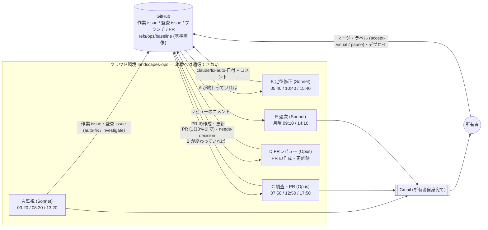

# 運用 — クラウドの定期タスク A〜E

Claude Code のクラウドのスケジュールタスク (claude.ai/code/routines) で、毎日の監視・定型修正・調査・PR のレビュー・週次レポートを回す仕組み。
**タスクの登録・有効化・マージ・デプロイは所有者が行う。** タスクは issue・ブランチ・PR・コメント・メールまでしか作らない。

## 全体図



時刻はすべて日本時間。cron は UTC で登録する (各シートに両方を書いてある)。毎時0分は避けている。

## 各タスクの役割

| | 役割 | 書くもの | シート |
|---|---|---|---|
| **A 監視** | ビルド → 全URLの HTTP とリンク → 1/7 のページをブラウザで (390px / 1440px) → 代表 364枚のスクリーンショット差分 → GA4 と Clarity → 異常を issue に | 作業 issue、監査 issue (`ops:finding` + `auto-fix` か `investigate`)、メール (異常があった日だけ) | [A.md](tasks/A.md) |
| **B 定型修正** | `auto-fix` を最大10件、1日1本のブランチ `claude/fix-auto-日付` で直して、該当ページだけ再監査 | ブランチ、issue へのコメント | [B.md](tasks/B.md) |
| **C 調査・PR** | B のブランチをレビューして PR に。`investigate` を調べ、直せるものは `claude/fix-番号` で直して PR に。判断が要るものは `needs-decision` で提案 | PR (1日3件まで)、コメント、メール | [C.md](tasks/C.md) |
| **D PRレビュー** | PR の作成・更新時に、CLAUDE.md のルールに沿ってレビュー | PR へのコメント1件 (同じコミットには1回) | [D.md](tasks/D.md) |
| **E 週次** | 傾向・改善の効果・所有者が判断すべき事項 | 週の作業 issue へのコメント、メール | [E.md](tasks/E.md) |

クラウド環境 (ネットワーク・環境変数・シークレット・セットアップスクリプト) は全タスク共通: [tasks/_environment.md](tasks/_environment.md)

### サブエージェント (`.claude/agents/`)
| 名前 | モデル | 使いどころ |
|---|---|---|
| `ops-state-checker` | Haiku | 開始時の判定 (完了済み / 続きから / 前段待ち)。追いかけ実行をすぐ終わらせる |
| `ops-scout` | Haiku | ファイル検索・件数のカウント・25言語の反映漏れの数え上げ |
| `ops-runner` | Sonnet | C (Opus) から、ビルドや監査の実行と集計を任せる |

## タスク間で状態を受け渡す方法

すべて GitHub に置く。読み書きは `node scripts/ops/state.mjs` を通す (同じ操作を2回しても重複しない)。

- **作業 issue** `[ops] YYYY-MM-DD` (ラベル `ops:daily`): A・B・C のチェックリスト。本文の末尾の `<!-- ops-state:{…} -->` に、開始回数・再開の目印・各タスクのデータ (解析の数字、監査の件数、B のブランチ、作った PR) を持つ。C が終わると閉じる。
- **ラベル**: `ops:in-progress` (作業中)、`ops:A-done` / `ops:B-done` / `ops:C-done` (順番の受け渡し)、`ops:halted` (止める条件に当たった)、`ops:stalled-twice` (同じ日に2回止まった)。
- **監査 issue**: `ops:finding` + `auto-fix` / `investigate` / `needs-decision`。本文の `<!-- ops-fp:… -->` (指紋) で同じ不具合を見分ける。翌日も出れば追記、出なければ「解消した可能性」と書く (自動では閉じない。PR の `Closes #番号` がマージで閉じる)。
- **基準画像**: git の独自の参照 `refs/ops/baseline` が指すコミットに、`baseline.tar.gz` (約26MB) を4MBずつに分けて置く。差分の画像は `refs/ops/diffs/YYYY-MM-DD` に7日間置き、issue からブラウザで見られる。`refs/ops/*` は通常の clone では取得されないので、リポジトリは重くならない。
  (最初は GitHub Release に置く設計だったが、クラウドの GitHub プロキシが JSON 以外の送信を受け付けず、初回の実行でアップロードが HTTP 415 になったため、2026-11-25 に変更した)
- **週の作業 issue** `[ops-weekly] YYYY-Www` (ラベル `ops:weekly`): E の進捗とレポート。

### 利用上限で止まったときの自動再開
1. 各タスクは区切りごとに作業 issue のチェックを付ける。
2. 追いかけ実行 (本来の5時間後と10時間後) が始まると、`ops-state-checker` が判定する:
   - `done` → すぐ終わる / `wait-prev` → 前のタスクが終わっていないので終わる / `running` → 90分以内に始まった実行がまだ動いているので終わる
   - `resume` → チェックの付いていない項目から再開 (A のビルドだけはセッションが新しいので毎回やり直す)
3. 3回目の開始 (= 同じ日に2回止まった) で `ops:stalled-twice` を付け、メールで知らせる。
4. 従量課金 (usage credits) では動かさない。上限中の実行は断られるだけで、次の追いかけ実行が拾う。3回とも断られた日は、その日の分は飛ぶ (翌日の A は新しい作業 issue で始まる)。

### 所有者が使う操作
| したいこと | 方法 |
|---|---|
| 見た目の差分を正として受け入れる | その監査 issue に `ops:accept-visual` を付ける → 次の A で基準画像が更新され、issue が閉じる |
| 全タスクを一時停止 | 何でもよいので issue を1件作り `ops:pause` を付ける (open のあいだ、全タスクが何もせず終わる)。閉じれば再開 |
| 1つのタスクを止める | claude.ai/code/routines でそのタスクを無効にする |
| 完全にやめる | 全タスクを削除 → `gh api -X DELETE repos/3jmcndrh-source/landscapes-of-japan/git/refs/ops/baseline` (差分の `refs/ops/diffs/*` も同様) → ラベル `ops:*` を削除 (任意) |
| 誤検知を黙らせる | `ops/audit-ignore.json` に正規表現と理由を足す (C が PR で提案することもある) |
| 代表ページを増やす | `ops/shots.json` の pages に足す (基準画像は次の A で自動追加) |

## 段階的な導入

最初は **A だけ**を有効にする。B〜E はシートを用意してあるだけで、登録しない (または登録して無効のままにする)。

### 0. 準備 (1回だけ)
- [x] 既定ブランチ = `cloudflare-migration`、保護ルール `protect-production` (2026-11-25 設定済み)
- [x] 本番を叩く GitHub Actions (Daily Health Check / Weekly Full URL Audit / Core Web Vitals) と Monthly Keyword Update を停止 (2026-11-25)
- [ ] この変更一式を `cloudflare-migration` に入れる (タスクは既定ブランチのスクリプトを使う)
- [ ] クラウド環境 `landscapes-ops` を [_environment.md](tasks/_environment.md) のとおり作る
- [ ] Claude GitHub App がこのリポジトリに入っているか確認 (D に必要)

### 1. A を登録して「Run now」で1回動かし、消費量を測る
1. A を [A.md](tasks/A.md) のとおり登録する (スケジュールはまだ無効でよい)。
2. **実行前に** claude.ai/settings/usage を開き、表示されている使用率 (5時間の枠と週の枠) を控える。
   ほかの作業 (この PC の Claude Code など) は止めておく。混ざると測れない。
3. A の詳細画面で **Run now**。終わるまで待つ (目安 30〜50分)。
4. **実行後に** もう一度 claude.ai/settings/usage を見て、増えた分を控える。これが A の1回分。
5. 確かめること:
   - [ ] 作業 issue `[ops] 今日の日付` ができ、A1〜A7 にチェック、`ops:A-done` が付いている
   - [ ] A-report のコメントに、http・browser・shots の結果と、解析データ (訪問者数など) が載っている
   - [ ] 初回なので、スクリーンショットは「新規 364・差分 0」、`gh api repos/3jmcndrh-source/landscapes-of-japan/git/ref/ops/baseline` が見つかる
   - [ ] 異常があった場合、監査 issue が重複なくできている。メールが届いた (または下書きができた)
   - [ ] ビルドの所要時間と監査の時間 (A-report に出る) が想定内 (合計 60分以内)
   - [ ] **もう一度 Run now** → 数分で「done」で終わる (追いかけ実行が軽いことの確認)。この分の消費も控える
6. 問題がなければ、A のスケジュールを有効にし、**ローカルの定期タスク `landscapes-daily-analytics` を止める** (Clarity の1日10回を2か所で使わないため)。
7. 2〜3日そのまま回し、毎日の消費量と、誤検知の有無を見る。

### 2. B を有効にする (A が安定してから)
- 確かめること: `auto-fix` の issue がある日に、`claude/fix-auto-日付` ブランチができ、issue に B のコメントが付く。cloudflare-migration には何も push されていない。翻訳文を書いていない。auto-fix が無い日は数分で done になる。

### 3. C を有効にする
- 確かめること: B のブランチから PR が1件でき、`Closes #番号` が入っている。`investigate` の issue に調べた内容のコメントが付く。PR は1日3件を超えない。メールが届く。Opus の消費量 (最も重い) を settings/usage で確認する。

### 4. D を有効にする
- 確かめること: C の PR に、レビューのコメントが1件だけ付く。同じ PR に push し直すと、新しいコミットに対して1件増える (同じコミットには増えない)。承認やマージをしていない。

### 5. E を有効にする
- 確かめること: 月曜に週の作業 issue ができ、傾向・改善の効果・判断すべき事項が書かれ、メールが届く。外部への発信や AI の文章の追加など、決めた方針に反する提案が入っていない。

## 利用枠の見積もりと、重いときの調整

正確な値は上の「Run now で測る」で確かめる。ここでの見積もりは考え方と相対的な重さ:

| タスク | 1回の目安 (実時間) | 重さの理由 | 重いときの調整 |
|---|---|---|---|
| A | 30〜50分 | ビルド・監査は待ち時間で、トークンはほとんど使わない。スクリプトは数KBの要約しか出さない。モデルの往復は30〜50回程度 | ブラウザ監査を 1/14 に (`--shard` を2週で一周に)、スクリーンショットを週1回に |
| A の追いかけ | 1〜3分 | 判定だけ | — |
| B | 0〜40分 | 直す issue がある日だけビルド1回 | 毎日 → 隔日、1回の上限を10件から5件に |
| C | 10〜90分 | Opus で調査と修正。PR ごとにビルド (ops-runner が実行) | 1回に扱う investigate を3件に、隔日に |
| D | 5〜20分 | PR の差分の量しだい | フィルターに Head branch `starts with claude/` を足し、自分の PR は対象外に |
| E | 5〜10分 | 集計はスクリプト | — |

- CLAUDE.md (約56KB) が毎回自動で読み込まれ、各往復の入力に乗る。キャッシュが効くので費用は小さいが、これが固定費の大部分。
- いちばん効く調整は C の頻度と件数。次が A のブランチ監査の範囲。
- 実測: 手元 (Windows) で http 1分・browser 6分 (1,370ページ × 2幅)・shots 2分 (364枚)。クラウドの4コアでも同程度の見込み。

## 手元で動かす

```bash
npm run build
node scripts/ops/audit.mjs --phase=http
node scripts/ops/audit.mjs --phase=browser --shard=auto
node scripts/ops/audit.mjs --phase=shots      # 比べる基準は ops-out/shots/baseline/ (visual.mjs pull で取得)
node scripts/ops/report.mjs                   # ops-out/summary.md
node scripts/ops/analytics.mjs --no-clarity   # Clarity は1日10回までなので手元では付ける
```
- Git Bash で `--paths=/en,...` を渡すときは、先頭に `MSYS_NO_PATHCONV=1` を付ける (付けないと `/en` が `C:/Program Files/Git/en` に化ける)。
- 手元 (Windows) のスクリーンショットはクラウド (Linux) と文字の描画が違うので、**手元で撮った画像を基準画像として上げない** (`visual.mjs push` は手元で実行しない)。

## 既知の制約・確認待ち

- **Gmail コネクタで送信できるかは、Run now で確かめる。** 送信の機能が無ければ、タスクは下書きを作る (受信箱には届かない)。その場合は通知の方法を決め直す。
- GitHub の一覧 API は、作った直後の issue を数秒返さないことがある。`state.mjs` は作った issue の番号を作業 issue にも記録して二重起票を防いでいる (2026-11-25 に再現して修正)。
- ホームの地図は `raw.githubusercontent.com` から地図データを読み、撮影地ページは `api.open-meteo.com` から天気を読む。監査ではどちらも遮断するので、地図は読み込み中の表示、天気は無しで写る (毎日同じなので差分にはならない)。
- `IndexNow on Push` の Actions は `master` への push で動く設定のまま。既定ブランチを変えたので、今は動かない (必要なら `cloudflare-migration` に直す)。
